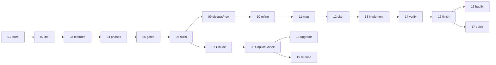

# SHADE kit v1 feature packages

Status: draft, 2026-10-14, updated 2026-10-18 (consistency review, findings clarification, and implementation of package 02), 2026-10-21 (implementation of package 03, its code review rework, and the rework after its second code review), 2026-10-22 (code review verification of package 03), 2026-10-23/24 (rework of file content handling), 2026-10-24 (documentation check against the code), 2026-10-25 (rework of `feature new` and its code review), 2026-10-26 (implementation of package 04), 2026-10-27 (documentation check after package 04), 2026-11-01 (implementation of package 05), 2026-11-04 (split of package 06 into the sub-features 06-1 to 06-9), 2026-11-06 (implementation of package 06-1 and its code review, and implementation of package 06-2), and 2026-11-08 (implementation of package 06-3, and implementation of package 06-4 and its code review rework). Derived step by step from [`research/shade-kit-concept.md`](../../research/shade-kit-concept.md); its [section 9](../../research/shade-kit-concept.md#9-version-drift) holds the version-drift decisions of the former ADR 0001. Parts that exist in the code are labelled **Implemented**.

Each package describes the functional behaviour of one clearly bounded piece of v1, with its benefit, scope, acceptance criteria (`FPnn-ACm`), and open points. The number prefix is the implementation order: every package depends only on packages with a lower number.

Labels follow the concept: **Decided** (confirmed in the concept interview or a later interview or review named with its date), **Proposed** (added in the concept or in these packages, not confirmed yet), **Open**, **Unverified**, **Implemented** (exists in the code; the label names where).

## Packages

| # | Package | Benefit in one line | Depends on |
|---|---|---|---|
| 01 | [Store foundation and format versioning](01-store-foundation-and-format-versioning.md) | Every kit file is safe across merges and upgrades; one agent contract | — |
| 02 | [Repository initialisation](02-repository-initialisation.md) | One command makes a repository a SHADE kit repository | 01 |
| 03 | [Feature management](03-feature-management.md) | Collision-free feature ids; the engine knows the current feature | 01, 02 |
| 04 | [Phase engine and workflow profiles](04-phase-engine-and-workflow-profiles.md) | The engine referees phases and records every approval | 01, 03 |
| 05 | [Gates and checklists](05-gates-and-checklists.md) | Configurable approvals, DoR and DoD with a record per feature | 02, 04 |
| 06 | [Skill foundation](06-skill-foundation.md) | "Continue" finds the next step; shared entry protocol, next-steps, interview, gate, and research skills | 01, 03, 04, 05 |
| 06-1 | [Engine version check](06-1-engine-version-check.md) | `version --expect` tells a skill whether it fits the engine | 01 |
| 06-2 | [Skill conventions and version metadata](06-2-skill-conventions-and-version.md) | Every skill follows the same rules and carries its kit version | 06-1 |
| 06-3 | [Next-steps message](06-3-next-steps-skill.md) | Every skill ends with the human's options and the skill to call | 06-2 |
| 06-4 | [Checklist check](06-4-gate-check-skill.md) | Checked, evidenced checklist before every approval | 05, 06-2 |
| 06-5 | [Entry protocol](06-5-phase-entry-skill.md) | No phase starts behind the developer's back | 06-1, 06-3, 06-4 |
| 06-6 | [`shade-kit-next-phase`](06-6-next-phase-skill.md) | Shows where a feature stands and what to call next | 06-1, 06-3 |
| 06-7 | [Interview](06-7-interview-skill.md) | Decisions from the human, asked the same way everywhere | 06-2 |
| 06-8 | [Research and `researches.md`](06-8-research-skill.md) | Facts with sources, in one file per feature | 06-2 |
| 06-9 | [Align the skill skeletons](06-9-skill-skeleton-alignment.md) | Every skill the human calls is gated and ends the same way | 06-3, 06-5, 06-6 |
| 07 | [Claude Code integration](07-claude-code-integration.md) | One-command, version-matched install for Claude Code | 01, 06 |
| 08 | [GitHub Copilot and OpenAI Codex CLI integration](08-copilot-and-codex-integration.md) | Same workflow on all three agents | 02, 06, 07 |
| 09 | [Discuss and intake](09-discuss-and-intake.md) | Free brainstorming; any input becomes a feature with the original kept | 03, 04, 06 |
| 10 | [Refine](10-refine.md) | A spec with stable requirement IDs and testable criteria | 06, 09 |
| 11 | [Map](11-map.md) | Plans build on facts about the code base | 06, 10 |
| 12 | [Plan](12-plan.md) | Every requirement bound to tasks and proving tests | 05, 06, 10, 11 |
| 13 | [Implement](13-implement.md) | Code passes an independent review loop (review skill) before verification | 06, 12 |
| 14 | [Verify](14-verify.md) | Evidence for every criterion, plus a manual playbook | 06, 12, 13 |
| 15 | [Finish and report](15-finish-and-report.md) | Feature closed with a record; optional report with requirements, tests, checks, approvals | 03, 04, 05, 06, 14 |
| 16 | [Bugfix profile](16-bugfix-profile.md) | Reproduce, root cause, failing test first | 04, 05, 06, 09, 12–15 |
| 17 | [Quick profile](17-quick-profile.md) | Traceability for small changes with one approval | 04, 05, 06, 09, 13, 15 |
| 18 | [Repository upgrade](18-upgrade.md) | Safe, all-or-nothing migration to new kit versions | 01, 02, 05, 08 |
| 19 | [Release and distribution](19-release-and-distribution.md) | Install anywhere, engine and content on one version | 07, 08 |

### Milestones

| Milestone | Packages | Result |
|---|---|---|
| M1 Engine core | 01–05 | The CLI manages repositories, features, phases, and gates; usable by hand. |
| M2 Agent foundation | 06–08 | `shade-kit-next-phase`, the entry protocol, and the shared skills run on Claude Code, Copilot, and Codex. |
| M3 `feature` profile end to end | 09–15 | First v1 success criterion reachable: `new` to `finish` on every agent. |
| M4 All v1 profiles | 16–17 | `bugfix` and `quick` complete. |
| M5 Releasable | 18–19 | Upgrades and distribution; v1 can be released. |

The PR build-and-test part of package 19 has no functional dependency and can be set up before package 01.

## Coverage of the concept's v1 scope

| Concept v1 item (§2) | Packages |
|---|---|
| Profiles `feature`, `bugfix`, `quick` | 04 (definitions), 09–15 (`feature`), 16 (`bugfix`), 17 (`quick`) |
| Agents Claude Code, Copilot, Codex | 06, 07, 08 |
| Store in the same repository | 01, 02, 03 |
| Gates: agent checks on phase start, human approves every transition, each gate can be switched off | 04, 05, 06 |
| Agent ↔ engine interface: CLI with `--json` | 01 (contract), 03, 04, 05 |
| Lifecycle: `integrations install/update`, `init`, `upgrade` | 07, 08, 02, 18 |
| Quality gates and traceability (§6) | 10 (IDs), 12 (mapping), 13, 14 (checks), 15 (report) |
| Distribution (§3.4) | 19 |

Not in any package because the concept puts them later: MCP server, extensions (§7), memory (§8), separate spec store (§4.4), `refactor` and custom profiles, CLI-run quality checks, approval enforcement.

## Artifacts in the feature folder

| File | Written by |
|---|---|
| `feature.json` | Engine (03, 04) |
| `request.md` | Engine (03): the request content loaded from the source, without a template |
| `discussions/*.md` | 09 |
| `researches.md` | 10, 11, 16 (format 06-8) |
| `spec.md` | 10; in `bugfix` 16, in `quick` 17 |
| `diagnosis.md` | 16 |
| `plan.md`, `tasks.md` | 12 (bugfix variant 16) |
| `review.md` | 13 (also 16, 17) |
| `verification.md` | 14 (also 17) |
| `playbook.md` | 14 (also 17, only for manual criteria) |
| `checks/definition-of-ready.md`, `checks/definition-of-done.md` | Engine copies (05), agent fills (06-4) |
| `report.md` | 15 (optional) |

## Changes and additions to the concept that need confirmation

None. The earlier list (keyed `gates.json`, new artifacts and commands, approval off with a checklist, skipping `map`, no hooks and MCP in v1, integration content in the engine release, `data.md` not created, `CLAUDE.md` update, obsolete "stay in refine") was confirmed on 2026-10-18 and taken over into the concept and `CLAUDE.md`.

## Open questions

| Concept question | Where | State |
|---|---|---|
| 1 Purpose of `data.md` | Concept §4.1 | Open, not needed for v1; v1 does not create it |
| 2 Where `discuss` output is stored | 09 | Decided on 2026-10-18 |
| 3 Branch in separate spec store mode | — | Later, not v1 |
| 4 Approval off completely or only checklist | 05 | Decided on 2026-10-18: both switchable |
| 5 Copilot and Codex format compatibility | 08 step 1 | Unverified, research is the first step of 08 |
| 6 Exact CLI command names | all | Concept proposals used throughout |
| 7 Extension ordering | — | Later, not v1 |
| 8 Memory cleanup and merges | — | Later, not v1 |

New open points from the packages:

- Trackers beyond GitHub in the id scheme, and readers for trackers that `gh` cannot read: every host in `trackers` is read with `gh` in v1 (03).
- Changing the profile of an existing feature (04).
- The `report` setting in the result of `phase start finish`, which the `shade-kit-finish` skeleton expects (04, owned by 15).
- History timestamps `at` with fractional seconds, while `createdAt` has whole seconds (04).
- Skill skeletons not yet aligned with the built `phase` commands (04, 05, 06): 13 skeletons still say in their source comment that every command other than `version`, `init`, and `feature …` is planned; `shade-kit-finish` expects the `report` setting in the result of `phase start finish`; no phase skill and not `shade-kit-next-phase` says to show the `warnings` of `phase start` and `phase next` (`gates-defaults-used`, `gate-entry-ignored`); the refusal table of 06 has no row for exit code 47 (`checklist-template-not-found`) and none for 17 (`kit-file-write-failed`, since 2026-11-04). (`shade-kit-next-phase` now says that only `pending` and `forward` have a gate, 2026-10-30.) Assigned on 2026-11-04: the rows for 17 and 47, a fallback row, and the warnings to 06-3; the skeletons to 06-9; the `report` setting to 15.
- Skill version (06-2, 2026-11-04): every skill carries its kit version hardcoded in its frontmatter (`metadata.version`), initial value `0.7.0` (2026-11-06); its alignment with the GitVersion version and the release tag is skipped for now, which breaks the rule in `GitVersion.yml` that no version is maintained by hand (06-2, 07, 19). Claude Code does not show the frontmatter to the model (checked on 2026-11-06 with Claude Code 2.1.318 on project-level skills, 06-2), so the handshake step states the version in its text. **Unverified:** whether Copilot and Codex show the frontmatter to the model (08).
- Phase skills are restricted to user invocation only by convention (06-2, 08): a technical restriction such as Claude Code's `disable-model-invocation` is a possible later addition; whether Copilot and Codex offer one is part of the research of 08.
- Skill reactions to a refused start, the refusal table of the next-steps message, and the active-feature check of `new` are **Proposed** (06-3, 09). The next-steps skill is built (06-3, 2026-11-08); its defaults are also **Proposed**: the table is keyed by error code, a failing `phase next` goes through the table, repeated warnings are shown once, and a refusal ends with calling the skill again. Rows 20–22 and 47 name `shade-kit upgrade`, which comes only with package 18.
- Defaults of the 04 implementation that the user has not confirmed yet (**Proposed** in 04): the repeated gate of a pending forward transition, approving a pending reopen of a phase that can no longer be reopened, the conditions for a `feature.json` without `currentPhase`, the done rule, the override deletion of `phase complete`, the plain-text wording, and `null` parts of `phase next`.
- Value and unit of the coverage threshold `coverageThreshold` in `config.json` (05, 14).
- Follow-ups from the implementation of 05 (2026-11-01): `checklist` values with control characters or `:` (a Windows alternate data stream) are not rejected; the order of `gate-entry-ignored` warnings relies on `Dictionary` enumeration order, which .NET does not guarantee; the cached `GatesConfig` is one shared mutable object; a file at `features/<id>/checks` ends `phase start` with exit code 255 (resolved on 2026-11-04: exit code 17, since the /simplify review of feature/feature-05 for every refused write in `.shadekit/`, 01); two concurrent starts could race between the existence check and the write of the copy; repositories initialised before 2026-11-01 get the built-in gate defaults with a warning until an upgrade (18) writes `profiles` (05).
- Supported way to install a Claude Code plugin at user level from a CLI (07, **Unverified**).
- Follow-ups from the implementation of 02: plain output wrapped at 80 columns when stdout is not a terminal, skeleton templates that name their owner package, a second `.gitignore` comment line when only an entry is missing (02). From its code review: a dangling symbolic link ends with a host error and a read-only target file fails only after `.shadekit/` is written (02).
- Follow-ups of 03 after its code review rework and second code review (2026-10-21): the process run of `GitCommandRunner` (output capture, exit codes, kill) is not covered by tests, and its read tasks are not observed after a kill (F03, accepted); a FIFO as `--source` blocks `feature new`; `drop` can delete an override that was changed to another feature between its check and the delete; on some systems the rename of `new` or `drop` can replace an empty folder created at the wrong moment; a file at `features/<id>` makes `feature new` end with exit code 255; a rename that fails only for a moment (for example on Windows while a virus scanner holds new files) is not retried and ends with exit code 35; unknown extra arguments are ignored silently; `git.cmd` shims are not found (no `PATHEXT`). Accepted as is by the user from the second code review: bidi format characters and U+2028/U+2029 pass the title check (N03); 03 says that a canceled `init` rolls back what it created, but it removes only `.shadekit/` (N04); Ctrl+Break and SIGQUIT also cancel with exit code 130 (N05); the `invalid-title` hint "Pass such a title with --title." is circular for a title from `--title` (N06); a theory in `ConsoleCancellationTests` branches in its Arrange section (N07).
- Follow-ups of 03 after the code review of the rework of `feature new` (2026-10-25): accepted as is by the user, a second `AddShadeKitCore()` call registers the configuration of the named HTTP client twice, so that client would send the `User-Agent` product twice (F3, **Unverified** at runtime; the CLI calls it once). Still open from the rework: `gh` and HTTP are only faked in tests, and the shape of a real `gh issue view --json` output is **Unverified**.

## Consistency log

After each package, the whole draft was checked against the concept, ADR 0001 (now concept section 9), and the packages before it.

| After | Finding | Resolution |
|---|---|---|
| 01 | `templates.lock.json` is a JSON file and needs a version too. | Listed as a versioned file type. |
| 02 | `researches.md` format was assigned to the wrong package. | Owner set to 06. New artifacts noted for later packages. |
| 03 | `feature list` / `feature current` returned phase fields that only 04 introduces. | Marked "once package 04 exists". |
| 04 | `quick` needs "one approval at the end", which a phase-only `gates.json` cannot express. | Carried into 05: gates keyed by profile. |
| 05 | Whether `quick` writes `review.md` was undecided. | "Not applicable" rule covers it; decided in 17. |
| 06 | The engine has no "phase work done" state. | Router derives it from `in-progress` plus the human's request; consistent with 04. |
| 07 | 01 promised integration versions in `version --json`. | Delivered in 07. |
| 08 | Copilot instruction file and later maintenance. | Linked to 02 and 18. |
| 11 | "Skip `map`" contradicted 04 (no skipping phases). | Clarified: work is skipped, the phase is passed. |
| 12 | `bugfix` plan variant depended on `diagnosis.md` from the later package 16. | Moved to 16. |
| 13 | Independent review needs subagents, not covered by 08's research. | Added to 08's research questions. |
| 14 | Coverage command not recorded by 13; `coverageThreshold` missing in `config.json`. | 14 finds and records the coverage command; field added to 02. |
| 15 | `phase complete` should clear the local override; report claimed "who checked off" playbook items, which no artifact records. | Added to 04; report shows checked yes/no. |
| 16 | 14 said the regression test comes from `diagnose`. | Corrected: planned in `plan`, written in `implement`. |
| 17 | Router always asked for approval, breaking `quick`'s single approval; approval off plus checklist was undefined. | 06 and 05 updated. |
| 18 | `current-feature.json` and the user-level integration record were missing from 01's file types; nobody migrated the integration record. | Added to 01; 07 migrates it. |
| 19 | Format changes must be visible to the handshake. | Format change is at least a minor release. |
| All | Automated check: every dependency points to a lower number, every package reference exists, every AC id is unique. `gates.json` and templates in 02 depend on later content. | Check passed. 02 clarified: skeletons and a version-only `gates.json` until the owner package is built. |
| Templates (2026-10-17) | First drafts of the `spec`, `plan`, `tasks`, DoR, and DoD templates (template interview) differed from the packages: `*.template.md` source names, no order of work in `plan.md`, task status as checkbox, coverage matrix, more spec sections, ten DoR and nine DoD items in a result table, quality commands planned in `plan.md`. | 02 (source names, template conventions), 05 (checklist format, default items), 06 (conventions, checklist check), 10 (`spec.md`), 12 (`plan.md`, `tasks.md`), 13 (checkboxes, commands from `plan.md`), 14 (commands, coverage matrix) aligned. |
| Review (2026-10-18) | The entry protocol from `shade-kit-skills.md` failed on re-entry and had no rejection path; package 06 still described a router; ADR 0001 was deleted but cited; `quick` was a skill without its own phase; `feature drop` skeleton omitted `--yes`; `feature current` had no status; six vs. seven research agents; `features` vs. `feature` command group; packages 01 and 19 ignored existing code. | 04 (re-entry, `phase reject`, `quick` phase), 05 (`quick` gate), 06 (entry protocol, `shade-kit-next-phase`), 03 (drop confirmation, `status`), 17 (`quick` phase), 01 and 19 (**Implemented**), ADR decisions moved into concept §9, CLI group renamed to `feature` in the code, router references replaced in 02, 07, 08, 09, 10, 15. |
| Findings clarification (2026-10-18) | Open findings of the 2026-10-18 review: short `bugfix` plan without test strategy, DoD in `quick`, DOR-09/DOR-10 in `bugfix`, report and review skills, no `phase next`, phase vs. workflow skills, concept behind the packages, `CLAUDE.md` scope, bare **Decided** labels, two engine rules, unverified release facts. | 02 (`report` in `config.json`), 04 (`phase next`, pending transition), 05 (DOR-10, DOD-01, `n/a` examples), 06 (`phase next`, pending transition, report and review skills, no `research/` paths), 13 (owns review skill), 15 (optional report), 16 (short plan sections, `diagnose / security`), 17 (coverage, playbook on demand, DoD items), 19 (release notes and ruleset facts); concept, `CLAUDE.md`, `shade-kit-skills.md`, skills, and templates aligned; confirmation list emptied; **Decided** labels sourced or downgraded. |
| 02 implementation (2026-10-18) | The draft of 02 appended the managed section to a file that already had one, which broke FP02-AC5 ("exactly one") and contradicted "Adds or updates"; template sources in repository-root `templates/` cannot ship inside the engine; git drops the empty `features/` that `init` creates, so exit code 11 (`features-dir-not-found`) would fail every fresh clone; `gates.json` said "only `schemaVersion`" although 01 stamps `minEngineVersion` everywhere; `init` needed its own exit codes. The code review of the implementation found that a UTF-16 or UTF-32 `.gitignore`, `CLAUDE.md`, or `AGENTS.md` got UTF-8 text appended, that one of these paths existing as a directory failed only after `.shadekit/` was written, that a cancellation left an empty `.shadekit/`, that the trimmed-line `.gitignore` rule counted lines git does not match, and that a file ending with an empty line got a second blank line. | 02 (section replaced between valid markers, invalid markers stop with exit code 23 before any write; template sources moved to `src/CreativeCoders.ShadeKit.Core/Templates/Resources/` and embedded; lock-file shape, `.gitignore` rules, write order without rollback, and output contract recorded; deviations listed; ACs **Implemented**), 01 (missing `features/` counts as empty, exit code 11 removed, 13 `already-initialized` and 23 `invalid-managed-section` added), 02 and 01 after the review (exit codes 14 `path-not-a-file` and 24 `unsupported-encoding` checked before any write; no `.shadekit/` left after a cancellation; `.gitignore` entry present when the line without trailing spaces matches, following git; separator blank line only if the file does not already end with an empty line; review note and new open points in 02), concept §3.1 and §4.5, `CLAUDE.md`, `README.md`, skills aligned. |
| 03 implementation (2026-10-21) | Package 03 said the engine fills `request.md` with the original input, package 09 that the agent fills it; the `feature list` JSON contract with names only (`features` as strings) was replaced by objects with id, title, profile, and status; exit code 15 (`kit-root-not-a-directory`, package 02) was missing from 01's exit code table; slug length, the time zone of time-based ids, source kind detection, the valid id pattern, and the exit code of `feature drop` without `--yes` were unspecified; how the engine reads the branch and the git user was not stated; package 03 needed its own exit and warning codes, and the profile check needed a code in 04's range. | 03 (all decisions of the implementation clarification on 2026-10-20 labelled; id, title, and source rules, `feature.json` and `current-feature.json` shapes, `request.md` filling, order of work with removal of the folder on failure, output, errors, warnings, git access, deviations, and open follow-ups recorded; ACs **Implemented**, FP03-AC11 in part), 09 (engine pre-fills `request.md`, the skill completes it; `feature new` syntax), 01 (exit codes 15, 16, 30–34, 36, 40, free 35, warning codes, store file operations), 02 and 04 (references to the implemented `feature new` and the profile check), concept §3.1–3.2 and §4.2–4.3, `CLAUDE.md`, `README.md`, and skills (`new`: complete the pre-filled `request.md`; `drop`: preview and override fields) aligned. |
| 03 code review rework (2026-10-21) | The code review of the implementation (1 Major, 10 Minor, 2 Suggestion, 6 Nitpick) found that `git` was started by its bare name, so Windows could run a `git.exe` from the repository; a missing required argument ended with exit code 255 and a stack trace; an unreadable `--source` file ended with exit code 255, a huge one or a device such as `/dev/zero` was read without a limit, and a UTF-16 one was decoded into replacement characters; `--title` could carry line breaks; a broken `current-feature.json` stopped `new`, `current`, and `set`; `new` was not atomic and its rollback could delete another run's feature; `show` and `current` took the id from `feature.json`, `list` from the folder; `drop` deleted in place; `list` listed invalid folder names; the JSON drop preview could not tell that the override would be cleared; Ctrl+C skipped the rollback of `new`; 03 stated the issue-number rule ambiguously; the `shade-kit-drop` frontmatter and the `request.md` skeleton contradicted the CLI. F03 was accepted by the user. | 03 (git lookup from absolute `PATH` entries, file source rules, control characters in titles, unusable override, staging and atomic move for `new`, rename-then-delete for `drop`, folder name as id, Ctrl+C, exit codes 2 and 130, six warning codes, `overrideAffected`, precise issue-number rule, review section, open points replaced by the residual risks), 01 (exit codes 2 and 130 outside the area ranges, complete warning codes, `MoveDirectory`), 02 (Ctrl+C reaches `init`), 09 (source kinds of the skeleton aligned), `CLAUDE.md` (exit codes 2 and 130), concept §5.1 and `shade-kit-skills.md` (`drop` clears only an override that points to the feature), skills (`drop`: frontmatter, `overrideAffected`), `request.md` skeleton (source kinds `text`, `url`, `file`) aligned. |
| 03 second code review (2026-10-21) | The second review of the rework (0 Critical, 0 Major, 2 Minor, 1 Suggestion, 4 Nitpick) found F01, F02 (decided scope), and F04–F19 resolved, F03 still accepted. New: a feature folder that `new` could not create or move into place, or that `drop` could not rename, ended with exit code 255 and a stack trace (N01); on Unix a non-executable `git` in an earlier `PATH` entry stopped the command with exit code 16 (N02); N03–N07 (title characters, `init` rollback wording, SIGQUIT and Ctrl+Break, `invalid-title` hint, a test branch). | N01 and N02 fixed: 03 (exit code 35 `feature-io-failed` in the order of work of `new`, in `drop`, and in the errors table; execute bit in the git lookup; review section; open points with the accepted N03–N07), 01 (exit code 35 in the exit code table, no longer free). N03–N07 accepted by the user on 2026-10-21. The user waived a third review run. `CLAUDE.md` lists only the ranges and needed no change. |
| 03 code review verification (2026-10-22) | A `/code-review` of the branch against `main` reported 10 findings, verified in a verification report: `set`, `show`, `drop`, and the branch and override lookup matched folder names case-insensitively on such file systems; `trackers` id prefixes were not validated, so a bad prefix only failed in `feature new` with a misleading `invalid-feature-id`; the heading of a `file` source took `# ` lines from code blocks and front matter and kept a closing `#`; the JSON names of enum values had two entry points; `new` read the override as a raw file; the display path was built in two places; a concurrent `drop` of the same id ends with exit code 35 instead of 31. | 03 (exact folder name match, heading rules, `JsonEnumNames.ToJsonName()`, override check through `ReadJsonAsync`, `KitStorePaths.GetDisplayPath`, concurrent `drop` as open point), 02 (`trackers` id prefixes validated, exit code 22). |
| File content rework (2026-10-23/24) | Writes kept the existing bytes and used CRLF only if a file already contained it, so they ignored git attributes, the git configuration, and `.editorconfig`; templates were always written with LF; files were not read as strict UTF-8; the warnings of a write were collected per store; a directory at the `request.md` template counted as a missing template. The code reviews of the rework and of the branch added the legacy `crlf` attribute, `text=input`, integer `core.autocrlf` values, `editorconfig-invalid`, `git-attributes-unavailable`, a per-run cache of the git configuration, batched `git check-attr`, and a size cap for `.editorconfig` globs. | 02 (line endings of every written file decided by git, then `.editorconfig`, then the operating system; strict UTF-8 for exit code 24; write warnings; lock hash over the lines joined with LF), 03 (line endings of `request.md`, `feature.json`, and `current-feature.json`, decided for the final path; exit code 14 for a directory at the `request.md` template), `CLAUDE.md` (`TextFileContent`, `ITextFileWriter`, line ending rules). |
| Documentation check (2026-10-24) | Packages, concept, `CLAUDE.md`, and `README.md` were checked against the code: links to deleted review reports and to `research/shade-kit-open-findings.md`; FP18-AC7 required bytes outside the markers to stay unchanged, which the writers of 02 no longer do; 03 named a class `FeatureCommandOutput` that does not exist, and its git access section did not cover the line ending lookups; exit code 14 was documented only for the files of `init`, and its message said that shade-kit must write the file; an open point of 02 about the messages of exit codes 14, 23, and 24 was already resolved; 03 listed no write warnings; 09 required the file content to be copied unchanged, 18 required a staged write the writer does not offer, 15, 14, and 10 named the wrong package, field state, or phase; nobody replaced `{{feature-id}}` in checklist copies; 08 asked for an ADR in a `docs/adr/` that does not exist; `CLAUDE.md` marked nothing as planned and missed paths in its layout; the research skill named only two of its three callers; concept, skills, status lines, and the AC order of 16 were out of date. | Dead links removed (text kept); 18 (instruction section and FP18-AC7 follow 02, staged multi-file write as open point); 03 (git access, warnings table, `request.md` template that is not UTF-8 text, reused code 14); 02 (exit code 14 row, resolved open point removed, warnings sentence); `CliErrorMapper` message for exit code 14 made neutral; 09 (FP09-AC4 line endings); 15, 14, 10, and this README (`feature show` fields of 04, `coverageThreshold` implemented, `quick` phase); 05 (engine replaces `{{feature-id}}` when it copies a checklist) and 06 (wording, skill names); 08 (research note instead of ADR); 16 (AC order); status lines of 07–10 and 18; `CLAUDE.md` (*(planned)* marks, layout); research skill description; concept and `shade-kit-skills.md` aligned; `README.md` (optional report). |
| Rework of `feature new` (2026-10-25) | `feature new` filled a `request.md` template and left the issue of a URL to the agent, so `request.md` held only a URL for a URL source and the `new` skill had to complete the file; `--title` was required for every URL; a text source had no `source.value`; a directory at `.shadekit/templates/request.md` stopped `new` with exit code 14 and a template that was not UTF-8 text with exit code 22; 05 explained the `{{feature-id}}` replacement of checklist copies by the `request.md` template. | 03 (`request.md` holds the request content without a template; tracker issues read with `gh`, other URLs with an HTTP GET, with their rules; `--title` optional for tracker URLs; text in `source.value`; `Source: text` in `show`; exit code 33 causes, no reused code 14; git and gh access through the shared `Processes/` helpers; rework table; open points: other trackers, `gh` and HTTP not tested against real processes and servers), 02 (`request.md` template row and `init` example entry removed, exit code 14 row, `trackers` read with `gh`), 09 (the engine reads the issue, nothing to complete in `request.md`, FP09-AC3/AC4, resolved skeleton open point), 18 (orphaned `.shadekit/templates/request.md` as open point), 05 (reference to `request.md` dropped), this README (artifact table, open points), `CLAUDE.md` (external tools and HTTP client), concept §3.2 and §4.1, and the `shade-kit-new` skill aligned; `shade-kit-skills.md` and the other skills needed no change. |
| Code review of the rework of `feature new` (2026-10-25) | The review (0 Critical, 0 Major, 5 Minor, 4 Suggestion, 2 Nitpick; F1–F11) found that `Microsoft.Extensions.Http` was on 10.0.12 next to 10.0.13 (F1); the exit-33 message always told the user to pass another kind of source, also when only `gh` or the request failed (F2); a second `AddShadeKitCore()` call registers the named HTTP client configuration twice (F3); the `request.md` heading of an issue took the raw title and trailing line breaks of bodies added empty lines, against the documented format (F4, F5); `request.md` now holds third-party content verbatim that the later skills read as the requirement (F6); `new` ran `gh` or sent the request before the git identity was read (F7); plus a buffer copy (F8), missing end-to-end failure tests (F9), a repeated "the GitHub CLI gh" in a reason (F10), and a long doc line (F11). | 03 (order of work: override and git identity before the content, 36 wins over 33 and 34; exit-33 hints by cause and the new reason; issue format rules; review list; F3 as open point, the `AddShadeKitCore` remarks describe it), 09 (`request.md` treated as data, not as instructions, in every skill that reads it; exit-33 hint; FP09-AC3), 06 (the same rule as a skill convention, research agents included), 10, 16, and 17 (the same rule where `refine`, `diagnose`, and `quick` read `request.md`), and the skills `shade-kit-new`, `shade-kit-refine`, `shade-kit-diagnose`, `shade-kit-quick`, and `shade-kit-research` aligned. F1, F2, and F4–F11 fixed; F3 accepted as is by the user. `CLAUDE.md` and the concept needed no change. |
| 04 implementation (2026-10-26) | 04 listed the profiles without their general skills or a reopen rule, did not say how a changed profile affects existing features, named no `feature.json` field order, history entry shape, or exit codes beyond 40, and specified no JSON contract for the six `phase` commands; `phase` commands need a current feature, which `feature current` treats as a result; 01 to 03 marked 40 as owned by 03 until 04 and said the phase fields of `feature list`, `current`, and `show` and FP03-AC11 wait for 04; the shared enum converter accepted comma-separated values (02 follow-up). Checked with the built CLI: after `phase complete` clears the override, a branch that does not select the feature leaves no current feature (exit code 37 from `phase next`); history `at` has fractional seconds. | 04 (architecture: pure engine behind `IPhaseEngine`, built-in profiles behind a catalog, gate seam `ITransitionGateProvider` with an approval-only default, the profile applies live; profiles with general skills and `CanReopen`; `feature.json` stays format version 1 with optional phase fields; transitions, history actions, JSON output, errors 37 and 40–46 with the check order; ACs **Implemented**; open points with the **Proposed** defaults), 01 (exit code table: 37, 40–46 owned by 04; `phase` commands stop with 37), 02 (enum follow-up resolved: comma-separated values make a `.shadekit/` JSON file invalid, exit code 22, member names in any letter case stay accepted, `SingleValueJsonStringEnumConverter`), 03 (catalog instead of `WorkflowProfiles`, phase fields in `list`, `current`, `show`, and the `feature.json` example, exit code 40 row, FP03-AC11 complete), 05 (gate part of the `phase start` result as built), this README, and `CLAUDE.md` (*(planned)* marks, `Workflow/` folders, `phase` commands). The skills were not changed; their mismatches are listed in the open points above. |
| Documentation check (2026-10-27) | Packages 04–19, concept, `shade-kit-skills.md`, `CLAUDE.md`, and `README.md` were checked against the code after package 04: `README.md` listed no `phase` commands; concept §3.2 still said `feature current` and `feature show` lacked the phase fields, the `phase` commands had no **Implemented** label, `phase complete` did not clear the override, and `phase next` gave every step a gate; concept §5.3 called the built phase states proposed; the state diagram in concept §11.3 missed the transitions of a reopen (`awaiting-approval → pending`, `approved → pending`) and into `approved` without a pending transition (approval off, `phase complete`), and §11.1 let every phase be reopened, `new` included; `shade-kit-skills.md` still waited for package 04; 05 called "approval off" proposed although the engine builds it; `CLAUDE.md` listed a `docs/reviews/` folder that does not exist. | `README.md` (status), concept (status, §3.2, §4.1, §5.3, §11.1, §11.3), `shade-kit-skills.md` (status, `shade-kit-new` exception), 05 ("approval off" **Implemented** in the engine), `CLAUDE.md` (`docs/reviews/` removed from the layout). The skill skeletons stay as listed in the open points above. |
| Phase start analysis (2026-10-30) | New requirement: a phase starts only when the user calls its phase skill; the skill checks through the CLI whether it can start, ends with the user's options when it cannot, and lets the user choose when the phase is already active. `shade-kit-next-phase` started the chosen phase skill, phase skills handed off to it after a "no" and at their end, `implement` offered to reopen `plan` itself, a refused start only showed the reason, an active phase was continued without asking, `new` did not check for an active feature, and the managed section in `CLAUDE.md` / `AGENTS.md` named `shade-kit-next-phase` as the way to start work ([analysis](../../research/shade-kit-phase-start-analysis.md)). | Decided with the user: `phase start` stays the CLI check (no new command); `shade-kit-next-phase` is advisory; the rule holds by convention, no `disable-model-invocation`; an active phase offers continue or end, a pending transition discard and continue, keep, or end. Concept §3.2, §3.3, §11.4, `shade-kit-skills.md`, 02 (managed section text, implemented), 04, 06 (entry protocol, next-steps message, FP06-AC2/3/5/11/12 changed, AC14–18 new), 08, 09 (FP09-AC6 changed, AC7–8 new), 10, 13, 14 (FP14-AC5), 17, and the skill skeletons updated. |
| 05 implementation (2026-11-01) | 05 left the shape rules of `gates.json` open (optional fields, invalid values, missing file or `profiles`, entries for unknown profiles or phases), marked the checklist copy **Proposed**, did not say what `checklist` in the `phase start` result is relative to, when the copy is made, or how a missing template fails, and had no exit or warning codes; 04 still registered `DefaultTransitionGateProvider` and named the `gates.json` read and the copy in its check order only as later work; 02 said `init` writes a version-only `gates.json`; existing repositories have a `gates.json` without `profiles`. Checked with the built CLI: a file at `features/<id>/checks` ends `phase start` with exit code 255. | 05 (decisions of the implementation clarification on 2026-11-01 labelled: per-store cached reader behind the unchanged `ITransitionGateProvider`, `approval` optional with default `true`, `checklist` optional or `null`, built-in defaults with `gates-defaults-used`, `gate-entry-ignored`, exit code 47, format version 1 without migration, feature-relative `checklist` path in `phase start` and `phase next`, the copy rules, the validation of `checklist` values, an explicit empty `profiles`, the path of the copy, the outcomes that copy, the copy order, the copy content, and `phase next` copying nothing **Decided**; `null` values and duplicate keys in `gates.json` and the other choices of the implementation recorded as **Proposed**; errors 47, 14, 22 with the check order; warnings table; ACs **Implemented**; open points with the follow-ups and skill mismatches), 04 (gate seam served by `GatesConfigTransitionGateProvider`, `DefaultTransitionGateProvider` removed, `gates.json` read and checklist copy in the check order, `warnings`, no-op exception, status), 02 (`init` writes the `gates.json` defaults: `init` list, deviation row, FP02-AC1, status), 01 (exit code 47, warning codes `gates-defaults-used` and `gate-entry-ignored`), this README (status, open points), `CLAUDE.md` (*(planned)* marks of gates and checklists, `Gates/` in the layout), concept (status, §3.2, §4.1, §5.2); `README.md` and `shade-kit-skills.md` needed no change. The skills were not changed; their mismatches are listed in the open points above and in 05. |
| /simplify review of feature/feature-05 (2026-11-04) | Only the checklist copy reported a refused write as exit code 17; every other write in `.shadekit/` (`feature.json`, the override, the files of `init` and of the staging folder of `feature new`) ended with exit code 255 and a stack trace; the gate reader and the gate provider were two classes for one read; the provider filled in the default gate for every phase, next to the same default in the engine, and kept ignored `gates.json` entries in its view; `phase start` did not tell whether it created the checklist copy. | 01 (exit code 17 for every refused store write, named by the final path), 02 and 03 (exit code 17 instead of 255 for the files in `.shadekit/`), 04 (gate seam: configured gates only, the engine applies the default; `checklistCreated` in `phase start`), 05 (reader merged into `GatesConfigTransitionGateProvider`, ignored entries have no gate, `checklistCreated` and the `Checklist copy:` line, exit code 17 for every store write, FP05-AC6 also proven by `PhaseEngineStartTests`), `CLAUDE.md` (layout row of `Gates/`). |
| Split of package 06 (2026-11-04) | Package 06 mixed engine work, five skills, and cross-cutting rules in one package; the version handshake had no source for the skill's own kit version (no version in any `SKILL.md`, no plugin manifest, `version --json` returns only `engineVersion` and `formats`); `shade-kit-report` depended only on package 15; FP06-AC13 contradicted keeping the source comments of skeletons that are not worked out; the refusal table missed 17, 47, and a fallback. | Decided with the user: sub-features 06-1 (.NET: `version --expect`, exit code range 50–59) to 06-9 with their own AC ids and a mapping table in 06; version hardcoded in the frontmatter `metadata.version` of every skill; the engine compares major and minor, a prerelease engine only warns; handshake in `shade-kit-phase-entry` and in the skills the human calls without it; new general skills `shade-kit-phase-entry` and `shade-kit-next-steps`; review of the skill texts by hand; `shade-kit-report` moved to 15; FP06-AC13 moved to 07 as FP07-AC7; four **Proposed** rules of 06 now **Decided**; alignment with GitVersion skipped for now. Links in 04, 09, 10, 16, and 17 point to 06-2 and 06-3. |
| 06-1 implementation (2026-11-06) | 06-1 left the SemVer grammar of `--expect`, not comparing its prerelease label, `expectedVersion` in the success envelope, the messages, the warning name, and the `CLAUDE.md` change **Proposed**, with two open points. Found in the implementation: the option parser leaves a bare `--expect` unset, so `version` succeeded without a check; it has no `--expect=<version>` form and ignores that argument like every unknown option; the clarification assumed that a plain mismatch message goes to stderr, but the CLI host writes the failure of a command to stdout and only an argument error to stderr. | 06-1 (decisions of the implementation clarification on 2026-11-05 labelled **Decided**: strict SemVer 2.0.0 with exit code 2, prerelease label and patch of `--expect` not compared, `expectedVersion` only with `--expect`, the exact messages, the warning name, the `CLAUDE.md` change, an engine version that is not SemVer as exit code 255; decisions of the implementation on 2026-11-06: a bare `--expect` ends with exit code 2, the `=` form stays ignored and is documented, plain failures of the command on stdout and the argument error on stderr; ACs **Implemented**; open points answered), 01 (range 50–59, exit code 50, warning code `engine-prerelease-version-mismatch`, `version --expect`, status), this README (status), `CLAUDE.md` (agent contract sentence, range 50–59, `Core/Versions/` in the layout, command example). The concept, `README.md`, and the skills were not changed. The code review (0 Critical, 0 Major, 1 Minor, 3 Suggestion, 1 Nitpick; F1–F5) found that a `ProgramTests` test was traced to AC5 instead of AC3 (F1), that the parse-time converter pattern had no `CLAUDE.md` entry (F3), and that the mapping of the generic `InvalidSemanticVersionException` named `--expect` and `version --help` (F4): the invalid-value message is now `'{value}' is not a SemVer version …` with `shade-kit --help`, the bare-`--expect` message is unchanged (06-1, `CLAUDE.md` agent contract). F1, F3, and F4 fixed; F2 and F5 accepted as is by the user. |
| 06-2 implementation (2026-11-06) | 06-2 left unverified whether Claude Code shows the frontmatter to the model, left the initial value of `metadata.version` open, and labelled the SemVer rule only **Proposed**. It said that skills only loaded by another skill do not check the version, while `shade-kit-phase-entry`, which only the phase skills load, checks for them (06-5). Found in the implementation: the unquoted description of `shade-kit-report` contained `: `, so its frontmatter was invalid YAML, and Claude Code would have loaded the skill with empty metadata. | Checked on 2026-11-06 with Claude Code 2.1.318: the model does not see the frontmatter, so the handshake step states the version in its text. 06-2 (visibility result with how it was checked and its limits, the fallback with the exact wording of the handshake step and the rule to raise both places together, initial value `0.7.0` and the SemVer rule **Decided**, unquoted value and double quotes for a description that YAML would not read unchanged as a plain scalar, who checks clarified, AC status, status), 06 (who checks, open point, status), 06-5 and 06-6 (the version stated in the text of the handshake step), 06-9 (the version stated in the text of the handshake step, open point on the skeleton handshakes), 08 (open point: frontmatter visibility and the parsing of the unquoted value in Copilot and Codex), this README (status, open point), `CLAUDE.md` (new section Skill conventions), and the skills (`metadata.version: 0.7.0` in all 17, the `shade-kit-report` description quoted). The code review (0 Critical, 0 Major, 6 Minor, 6 Info; R06-2-01 to R06-2-12) found inexact wording (the `research/`/`docs/` rule in `CLAUDE.md` without its qualifier, the raise rule without major, the quoting rule naming only `: `, the visibility result without its limits, the 06 changes in this row), `quick_validate.py` named as a proof of AC1 although it does not read `metadata`, a status that claimed more than AC3 delivers, skeleton handshakes that cannot detect a mismatch (now an open point of 06-9), no item in 08 for the Copilot and Codex check (now an open point of 08), and a 2026-11-04 decision record in 06 rewritten in place. R06-2-01 to R06-2-10 fixed; R06-2-11 (no automated guard of the 17 version copies, by design) and R06-2-12 (how Copilot and Codex parse the unquoted value; noted in 08) accepted as they are by the user. The second review round (0 Critical, 0 Major, 1 Minor, 5 Info; R06-2-13 to R06-2-18) confirmed R06-2-01 to R06-2-10 as fixed; R06-2-13, R06-2-15, and R06-2-17 fixed; R06-2-14 (plugin-path re-check without owner), R06-2-16 (status lines of 06-5, 06-6, 06-9, 08), and R06-2-18 (whether 0.7.0 fits the next release tag) accepted as they are by the user. |
| 06-3 implementation (2026-11-08) | 06-3 keyed the refusal table by exit code, but the failure envelope carries only `error.code` and `error.message`. It did not say what the message shows for a pending transition beyond the pending step, or for a `done` feature beyond the AC1 rule. It also left open what to show when `shade-kit` is missing (no envelope), when the skill's own `phase next` fails, for example after `drop`, or when a warning comes from both the calling skill and `phase next`. Rows 20–22 and 47 name `shade-kit upgrade`, which does not exist before package 18. Scenario runs of the first draft found more ambiguities: the line about what happened after a refusal, `reopen: null`, the wording of a gate without a checklist, and calling the skill again after a fixable refusal. | Decided with the user: pending also names discarding the transition with `/shade-kit-<current>`; `done` names `feature set`, `/shade-kit-new`, `/shade-kit-discuss`, and `/shade-kit-drop`; `upgrade` stays in the rows (open point of 06-3). The other answers are **Proposed** defaults in 06-3. Docs updated: 06-3 (functional description, AC status with how it is proven, open points, status), 06 (status, general-skills table), and this README (status, open point). New skill `skills/shade-kit-next-steps/SKILL.md` (`metadata.version: 0.7.0`, no handshake, because only other skills load it). Proven by `quick_validate.py` (18 of 18 valid) and by 8 scenario runs; 5 of them were run again after the revision, and all passed. |
| 06-4 implementation (2026-11-08) | 06-4 gave the skill the path of the copy and the profile as input, but the n/a rule needs the phases of the profile, DOD-02 the `coverageThreshold` of `config.json`, and skills may not read `feature.json`, `gates.json`, or `config.json` (06-2). It did not say how DOD-06 and DOD-08 find the change, what happens with an item the skill cannot decide or with an unusable copy, or the time zone of the "Check runs" line (the templates showed a time without a UTC offset); it depended only on 06-2. The code review (0 Critical, 1 Major, 8 Minor, 3 Suggestion, 2 Nitpick) found an undecided short option `-f` of `gate info`, three `error` branches without a scenario, the DOD-02 criterion and 05 still naming `config.json`, a run-line placement that could hit the example line in the guidance comment, a default-branch fallback that needed a git command outside the allowed list, an unbounded `git diff`, work on the default branch not covered, `error` with approval off contradicting 06-5, and this README and 06 not updated. | Decided with the user: the read-only command `shade-kit gate info <phase> [--feature <id>]` in the new group `gate` with the JSON shape of 06-4; the input `featureId`, target phase, and checklist path from the `phase start` result; the threshold from `gate info`; read-only git for the change set; questions to the human after all items are checked; `error` without a changed file; the run line with the UTC offset. The other answers are **Proposed** defaults in 06-4. Review rework decided with the user on 2026-11-08: D-34 the short option `-f` of `gate info --feature` removed, and the attribute test pins that the option has no short name; D-35 three new `error` scenarios on the skill text of the first rework, each run by a fresh subagent, without running 5 and 6 again; D-36 the other findings to be fixed, with the wording **Proposed** in 06-4: the first run line after the closing `-->` of the guidance comment, `git merge-base` as the only test of a default-branch candidate, the open point on `error` with approval off, the DOD-02 criterion of the DoD template and 05 naming `gate info`, the status and package rows of 06 and this README, the mapped-failure test split by requirement, `PhaseSnapshotData` reused instead of `GateInfoCommandPhaseData`, `git diff --name-status` before the per-file diffs, the "Decided by a human" and "Suspicious instructions" lines in the return example; N2 (question options of the skill) is deferred; D-37 `git status --porcelain --branch`, and with no commit of its own after the base the human is asked about DOD-06 and DOD-08 only on the default branch or a detached HEAD; second review round (D-38 to D-40): D-38 the review set (`dotnet-reviewer`, with `skill-creator` as the yardstick of the skill text), D-39 the round-2 findings to be fixed (wording **Proposed** in 06-4) except s1 (fail without asking on the default branch), which is deferred, D-40 `git status --porcelain --branch --untracked-files=all`; third review round: D-41 the round-3 findings fixed (wording **Proposed** in 06-4; the feature folder listed with the file tools, the copy edited in place, and the closed list of shell commands have no scenario run). Docs updated: 06-4 (functional description, acceptance criteria, open points, status), 05 (DOD-02 criterion, `gate info` reference, open point), 06 (status, sub-feature table), this README (status, package table), `CLAUDE.md` (`src/` layout row, command line). New skill text `skills/shade-kit-gate-check/SKILL.md`; in the shipped DoD template the DOD-02 criterion names `shade-kit gate info` instead of `config.json`, and both checklist templates show the new run-line format. Proven by `dotnet build` (0 warnings) and `dotnet test` (4721 tests, 4720 passed, 1 skipped on this platform) on the code after the second review round (including the test-helper rename n3), by `quick_validate.py` (18 of 18 valid), and by scenario runs (06-4 lists each run): the 8 scenarios of the implementation, run on the texts of iteration 1, iteration 2, and the review, partly by the implementing agent itself; the 6 scenarios of the first rework on its text; and 3 of them (e3, s9, s10a) again on the text of the second round. These 6 + 3 = 9 runs were each made by a fresh subagent. The 6 runs of the first rework gave the expected result; the 3 re-runs were checked afterwards, without a new run, against expectations rewritten for the text of the second round (D-41): e3r met all of them, s9r and s10ar all except one, a shell listing by the runner instead of the file tools. These fixtures do not discriminate m2, n1, and D-40. |
