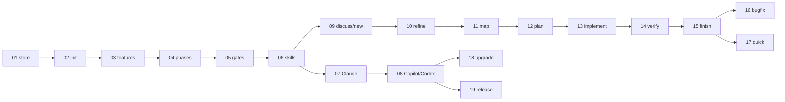

# SHADE kit v1 feature packages

Status: draft, 2026-10-14, updated 2026-10-18 (consistency review). Derived step by step from [`research/shade-kit-concept.md`](../../research/shade-kit-concept.md); its [section 9](../../research/shade-kit-concept.md#9-version-drift) holds the version-drift decisions of the former ADR 0001. Parts that exist in the code are labelled **Implemented**.

Each package describes the functional behaviour of one clearly bounded piece of v1, with its benefit, scope, acceptance criteria (`FPnn-ACm`), and open points. The number prefix is the implementation order: every package depends only on packages with a lower number.

Labels follow the concept: **Decided** (confirmed in the concept interview or a later interview or review named with its date), **Proposed** (added in the concept or in these packages, not confirmed yet), **Open**, **Unverified**, **Implemented** (exists in the code; the label names where).

## Packages

| # | Package | Benefit in one line | Depends on |
|---|---|---|---|
| 01 | [Store foundation and format versioning](01-store-foundation-and-format-versioning.md) | Every kit file is safe across merges and upgrades; one agent contract | — |
| 02 | [Repository initialisation](02-repository-initialisation.md) | One command makes a repository a SHADE kit repository | 01 |
| 03 | [Feature management](03-feature-management.md) | Collision-free feature ids; the engine knows the current feature | 01, 02 |
| 04 | [Phase engine and workflow profiles](04-phase-engine-and-workflow-profiles.md) | The engine referees phases and records every approval | 01, 03 |
| 05 | [Gates and checklists](05-gates-and-checklists.md) | Configurable approvals, DoR and DoD with a record per feature | 02, 04 |
| 06 | [Skill foundation](06-skill-foundation.md) | "Continue" finds the next step; shared interview, gate, research, report skills | 01, 03, 04, 05 |
| 07 | [Claude Code integration](07-claude-code-integration.md) | One-command, version-matched install for Claude Code | 01, 06 |
| 08 | [GitHub Copilot and OpenAI Codex CLI integration](08-copilot-and-codex-integration.md) | Same workflow on all three agents | 02, 06, 07 |
| 09 | [Discuss and intake](09-discuss-and-intake.md) | Free brainstorming; any input becomes a feature with the original kept | 03, 04, 06 |
| 10 | [Refine](10-refine.md) | A spec with stable requirement IDs and testable criteria | 06, 09 |
| 11 | [Map](11-map.md) | Plans build on facts about the code base | 06, 10 |
| 12 | [Plan](12-plan.md) | Every requirement bound to tasks and proving tests | 05, 06, 10, 11 |
| 13 | [Implement](13-implement.md) | Code passes an independent review loop before verification | 06, 12 |
| 14 | [Verify](14-verify.md) | Evidence for every criterion, plus a manual playbook | 06, 12, 13 |
| 15 | [Finish and report](15-finish-and-report.md) | One report with requirements, tests, checks, approvals | 03, 04, 05, 06, 14 |
| 16 | [Bugfix profile](16-bugfix-profile.md) | Reproduce, root cause, failing test first | 04, 05, 06, 09, 12–15 |
| 17 | [Quick profile](17-quick-profile.md) | Traceability for small changes with one approval | 04, 05, 06, 09, 13, 15 |
| 18 | [Repository upgrade](18-upgrade.md) | Safe, all-or-nothing migration to new kit versions | 01, 02, 05, 08 |
| 19 | [Release and distribution](19-release-and-distribution.md) | Install anywhere, engine and content on one version | 07, 08 |

### Milestones

| Milestone | Packages | Result |
|---|---|---|
| M1 Engine core | 01–05 | The CLI manages repositories, features, phases, and gates; usable by hand. |
| M2 Agent foundation | 06–08 | `shade-kit-next-phase`, the entry protocol, and the shared skills run on Claude Code, Copilot, and Codex. |
| M3 `feature` profile end to end | 09–15 | First v1 success criterion reachable: `new` to `finish` on every agent. |
| M4 All v1 profiles | 16–17 | `bugfix` and `quick` complete. |
| M5 Releasable | 18–19 | Upgrades and distribution; v1 can be released. |

The PR build-and-test part of package 19 has no functional dependency and can be set up before package 01.

## Coverage of the concept's v1 scope

| Concept v1 item (§2) | Packages |
|---|---|
| Profiles `feature`, `bugfix`, `quick` | 04 (definitions), 09–15 (`feature`), 16 (`bugfix`), 17 (`quick`) |
| Agents Claude Code, Copilot, Codex | 06, 07, 08 |
| Store in the same repository | 01, 02, 03 |
| Gates: agent checks on phase start, human approves every transition, each gate can be switched off | 04, 05, 06 |
| Agent ↔ engine interface: CLI with `--json` | 01 (contract), 03, 04, 05 |
| Lifecycle: `integrations install/update`, `init`, `upgrade` | 07, 08, 02, 18 |
| Quality gates and traceability (§6) | 10 (IDs), 12 (mapping), 13, 14 (checks), 15 (report) |
| Distribution (§3.4) | 19 |

Not in any package because the concept puts them later: MCP server, extensions (§7), memory (§8), separate spec store (§4.4), `refactor` and custom profiles, CLI-run quality checks, approval enforcement.

## Artifacts in the feature folder

| File | Written by |
|---|---|
| `feature.json` | Engine (03, 04) |
| `request.md` | 09 |
| `discussions/*.md` | 09 |
| `researches.md` | 10, 11 (format 06) |
| `spec.md` | 10; in `bugfix` 16, in `quick` 17 |
| `diagnosis.md` | 16 |
| `plan.md`, `tasks.md` | 12 (bugfix variant 16) |
| `review.md` | 13 (also 16, 17) |
| `verification.md` | 14 (also 17) |
| `playbook.md` | 14 |
| `checks/definition-of-ready.md`, `checks/definition-of-done.md` | Engine copies (05), agent fills (06) |
| `report.md` | 15 |

## Changes and additions to the concept that need confirmation

1. `gates.json` is keyed by profile, then by target phase (05). The concept example is keyed by phase only, which cannot express `quick`'s "one approval at the end".
2. New artifacts not in the concept tree: `discussions/` (09), `diagnosis.md` (16), `verification.md` (14), `report.md` (15).
3. New commands: `feature show`, `feature drop` (03), `phase complete`, `phase reject` (04). `feature drop` deletes only with `--yes` or after a console confirmation in an interactive terminal (03). Re-entry and reopen are expressed through `phase start` (04).
4. Approval off together with a checklist: the checklist is checked but only warns (05, 06).
5. "Skipping `map`" skips the work, not the phase (11).
6. Hooks and MCP configuration are not shipped in v1 because no v1 feature needs them (07).
7. The integration content is packed into the engine release (07); the kit never commits (13).
8. `data.md` from the concept tree is not used by any package (concept open question 1); v1 does not create it unless its purpose is decided.
9. `CLAUDE.md` still lists the old v1 phases (concept §2 note) and should be updated once the concept and these packages are accepted.
10. Concept §11.4 says "stay in refine" after a rejected gate into `plan`; with the `feature` profile the phase before `plan` is `map`. In these packages, a rejection resumes whatever phase is current (04, 06).

## Open questions

| Concept question | Where | State |
|---|---|---|
| 1 Purpose of `data.md` | README, change 8 | Open, not needed for v1 |
| 2 Where `discuss` output is stored | 09 | Concept proposal adopted, needs confirmation |
| 3 Branch in separate spec store mode | — | Later, not v1 |
| 4 Approval off completely or only checklist | 05 | Both switchable, concept proposal adopted |
| 5 Copilot and Codex format compatibility | 08 step 1 | Unverified, research is the first step of 08 |
| 6 Exact CLI command names | all | Concept proposals used throughout |
| 7 Extension ordering | — | Later, not v1 |
| 8 Memory cleanup and merges | — | Later, not v1 |

New open points from the packages:

- Trackers beyond GitHub in the id scheme (03).
- Changing the profile of an existing feature (04).
- Coverage threshold (05, 14; proposal `coverageThreshold` in `config.json`).
- Supported way to install a Claude Code plugin at user level from a CLI (07, **Unverified**).

## Consistency log

After each package, the whole draft was checked against the concept, ADR 0001 (now concept section 9), and the packages before it.

| After | Finding | Resolution |
|---|---|---|
| 01 | `templates.lock.json` is a JSON file and needs a version too. | Listed as a versioned file type. |
| 02 | `researches.md` format was assigned to the wrong package. | Owner set to 06. New artifacts noted for later packages. |
| 03 | `feature list` / `feature current` returned phase fields that only 04 introduces. | Marked "once package 04 exists". |
| 04 | `quick` needs "one approval at the end", which a phase-only `gates.json` cannot express. | Carried into 05: gates keyed by profile. |
| 05 | Whether `quick` writes `review.md` was undecided. | "Not applicable" rule covers it; decided in 17. |
| 06 | The engine has no "phase work done" state. | Router derives it from `in-progress` plus the human's request; consistent with 04. |
| 07 | 01 promised integration versions in `version --json`. | Delivered in 07. |
| 08 | Copilot instruction file and later maintenance. | Linked to 02 and 18. |
| 11 | "Skip `map`" contradicted 04 (no skipping phases). | Clarified: work is skipped, the phase is passed. |
| 12 | `bugfix` plan variant depended on `diagnosis.md` from the later package 16. | Moved to 16. |
| 13 | Independent review needs subagents, not covered by 08's research. | Added to 08's research questions. |
| 14 | Coverage command not recorded by 13; `coverageThreshold` missing in `config.json`. | 14 finds and records the coverage command; field added to 02. |
| 15 | `phase complete` should clear the local override; report claimed "who checked off" playbook items, which no artifact records. | Added to 04; report shows checked yes/no. |
| 16 | 14 said the regression test comes from `diagnose`. | Corrected: planned in `plan`, written in `implement`. |
| 17 | Router always asked for approval, breaking `quick`'s single approval; approval off plus checklist was undefined. | 06 and 05 updated. |
| 18 | `current-feature.json` and the user-level integration record were missing from 01's file types; nobody migrated the integration record. | Added to 01; 07 migrates it. |
| 19 | Format changes must be visible to the handshake. | Format change is at least a minor release. |
| All | Automated check: every dependency points to a lower number, every package reference exists, every AC id is unique. `gates.json` and templates in 02 depend on later content. | Check passed. 02 clarified: skeletons and a version-only `gates.json` until the owner package is built. |
| Templates (2026-10-17) | First drafts of the `spec`, `plan`, `tasks`, DoR, and DoD templates (template interview) differed from the packages: `*.template.md` source names, no order of work in `plan.md`, task status as checkbox, coverage matrix, more spec sections, ten DoR and nine DoD items in a result table, quality commands planned in `plan.md`. | 02 (source names, template conventions), 05 (checklist format, default items), 06 (conventions, checklist check), 10 (`spec.md`), 12 (`plan.md`, `tasks.md`), 13 (checkboxes, commands from `plan.md`), 14 (commands, coverage matrix) aligned. |
| Review (2026-10-18) | The entry protocol from `shade-kit-skills.md` failed on re-entry and had no rejection path; package 06 still described a router; ADR 0001 was deleted but cited; `quick` was a skill without its own phase; `feature drop` skeleton omitted `--yes`; `feature current` had no status; six vs. seven research agents; `features` vs. `feature` command group; packages 01 and 19 ignored existing code. | 04 (re-entry, `phase reject`, `quick` phase), 05 (`quick` gate), 06 (entry protocol, `shade-kit-next-phase`), 03 (drop confirmation, `status`), 17 (`quick` phase), 01 and 19 (**Implemented**), ADR decisions moved into concept §9, CLI group renamed to `feature` in the code, router references replaced in 02, 07, 08, 09, 10, 15. |
