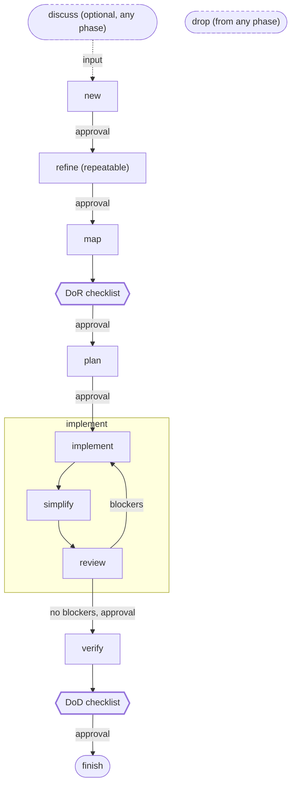
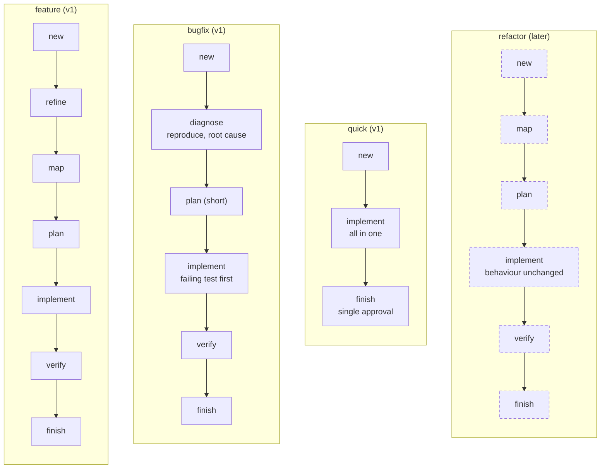
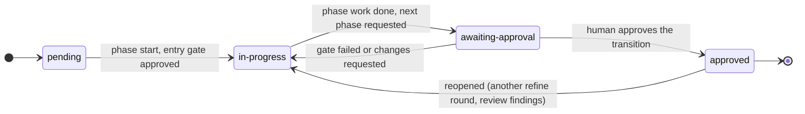
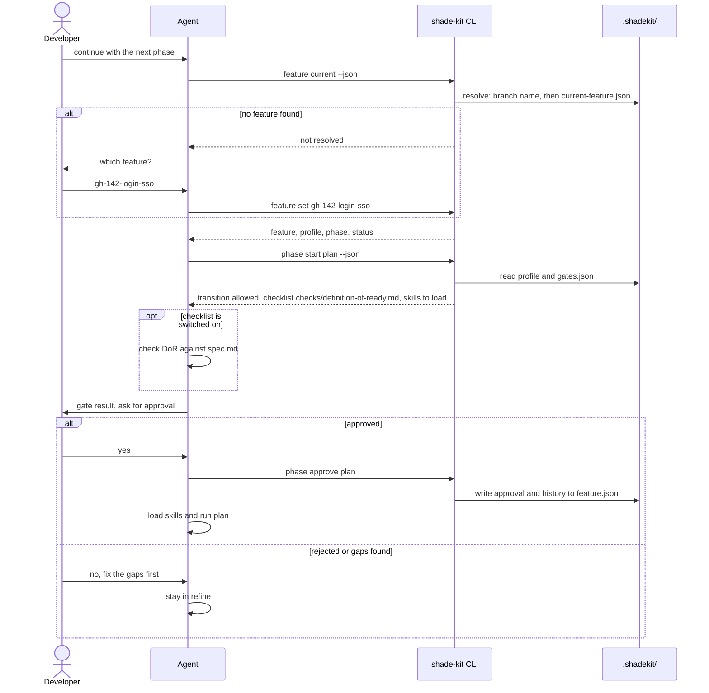

# SHADE kit concept

Status: draft, 2026-10-13. Result of an interview on the original working notes. Design notes only; nothing here is shipped.

Labels used in this document:

- **Decided**: confirmed in the interview.
- **Proposed**: added while working the notes into shape; not confirmed yet.
- **Open**: needs a decision before it is built.
- **Unverified**: an assumption about an external tool that has not been checked.

## 1. Purpose

SHADE kit replaces the `cc-ai-dev` skills (`create-dev-spec`, `create-dev-plan`, `implement-dev-plan`). Those skills work, but each run starts from scratch:

- no lasting feature state across sessions, branches, and merges
- no explicit gates between phases
- no distribution to more than one agent
- no update or migration path for repositories that already use them

SHADE kit keeps what worked (interviews, draft → approve, requirement-to-test mapping) and moves it into phase skills. A CLI engine (`shade-kit`) holds the state. The skills are the prompts; the engine is the memory and the referee.

**Users (decided):** small teams of 2–5 developers working on features in parallel, each on its own branch. Feature folders are committed and merged with the code.

**Success (decided):** a team can take a feature from `new` to `finish` with any of the three target agents, and the state survives branch switches, merges, and kit upgrades.

**Constraint (decided):** a capability is built for one agent only when an agent-neutral version would lose function or precision.

## 2. Scope

| Area | v1 | Later |
|---|---|---|
| Workflow profiles | `feature`, `bugfix`, `quick` | `refactor`, custom profiles |
| Agents | Claude Code, GitHub Copilot, OpenAI Codex CLI | |
| Store | Kit data in the same repository | Separate spec store repository |
| Gates | Agent checks on phase start, human approves every transition, each gate can be switched off | CLI enforces gates and runs quality checks itself |
| Agent ↔ engine interface | CLI with `--json` output | MCP server as a thin wrapper around the same core |
| Extensions | | `before` / `after` / `align` / `replace` slots, repository-local first, installable from git after that |
| Memory | | Knowledge distilled at `finish` |
| Lifecycle | `integrations install/update`, `init`, `upgrade` (migration) | |

> `CLAUDE.md` still lists the v1 phases as "spec → plan → implement → verify → review". This concept replaces that list with the phases in section 5. `CLAUDE.md` should be updated once this concept is accepted.

## 3. Components

```
┌───────────────────────── agent (Claude Code / Copilot / Codex) ─────────────────────────┐
│  phase skills + general skills + research agents   (installed at user level)            │
└───────────────┬─────────────────────────────────────────────────────────────────────────┘
                │ shade-kit … --json
┌───────────────▼──────────────┐        ┌──────────────────────────────┐
│  shade-kit CLI (engine)      │ ◄──────│ human: install, init, upgrade │
│  state, gates, profiles,     │        │ approve phase transitions     │
│  templates, migrations       │        └──────────────────────────────┘
└───────────────┬──────────────┘
                │ reads/writes
┌───────────────▼──────────────┐
│  .shadekit/ in the repository│
└──────────────────────────────┘
```

### 3.1 CLI for humans

| Command (proposed name) | Purpose |
|---|---|
| `shade-kit integrations install [--agent claude\|copilot\|codex]` | Sets up the agent integration (skills, agents, hooks, MCP config) at **user level**: as a plugin where the agent has one, otherwise by writing the same content to the agent's user directory. **Decided.** |
| `shade-kit integrations update` | Updates the user-level integration to the installed kit version. |
| `shade-kit init` | Creates `.shadekit/` in a repository: `config.json`, `gates.json`, templates, `templates.lock.json`, `.gitignore` entries, and a short SHADE kit section in `CLAUDE.md` / `AGENTS.md`. |
| `shade-kit upgrade` | Migrates an initialised repository to the current format versions. Rules in [ADR 0001](../docs/adr/0001-shadekit-version-drift.md). |
| `shade-kit version` | Prints the engine version. Exists already. Skills call it before they run (ADR 0001). |
| `shade-kit features list` | Lists the features in the store. Exists already. |

Skills and agent files are not written into the repository (ADR 0001, confirmed in the interview). The repository only holds kit data and the short instruction section.

### 3.2 CLI for agents

Agents call the same binary with `--json`. Every agent can run a shell command, so no extra integration is needed. **Decided.** An MCP server may come later as a thin wrapper around the same core services.

| Command (proposed name) | Returns / does |
|---|---|
| `shade-kit feature current --json` | The current feature: id, profile, phase, phase status, artifact paths. Resolution in section 4.3. |
| `shade-kit feature set <id>` | Writes the local override (`current-feature.json`). |
| `shade-kit feature new --profile <p> --source <text\|url\|file>` | Creates the feature folder and `request.md`. |
| `shade-kit phase start <phase> --json` | Checks that the transition is allowed by the profile. Returns the entry gate (checklist path and whether it is on) and the skills to load. |
| `shade-kit phase approve <phase>` | Records the human approval in `feature.json` (who, when). |
| `shade-kit phase skills <phase> --json` | The skills to load before the phase runs, including extension skills later. |
| `shade-kit extensions get --phase <p> [--slot <s>] --json` | Extension bindings for a phase. **Later.** |
| `shade-kit memory get [--topic <t>] --json` | Relevant memory entries. **Later.** |

> **Weak point in v1 (decided, known):** the agent calls `phase approve` after the human says yes in the chat. Nothing technically prevents an agent from approving on its own. Stronger options for later: `approve` only works in an interactive terminal, or a hook blocks the call.

### 3.3 Skills and agents

- **Phase skills:** one per phase (`shade-kit-refine`, `shade-kit-plan`, …), plus a router skill that asks the CLI for the current feature and phase and hands off to the right phase skill. **Proposed.**
- **General skills:** used across phases, for example an interview skill, a checklist-check skill for gates, and a skill that writes reports.
- **Research agents:** one subagent per focus, run in parallel, results merged into `researches.md`:

| Focus | Used in |
|---|---|
| Gaps and open questions in the requirement | `refine` |
| Security concerns and considerations | `refine` (at requirement level) and `map` (at code level) |
| Best practice | `map` |
| Existing architecture | `map` |
| Existing affected code | `map` |
| Don't hand-roll: existing frameworks, libraries, APIs | `map` |

The split between `refine` and `map` is **proposed**: `refine` deals with the requirement, `map` with the code base.

### 3.4 Distribution

- CLI as a `dotnet` global tool and as self-contained single-file binaries (see `CLAUDE.md`). An installer script for the binaries is **proposed**.
- Plugin and CLI are released together under one version number and check each other's version (ADR 0001).
- Claude Code: plugin. Copilot: plugin if available, otherwise user directory. Codex: user directory. **Unverified:** whether Copilot and Codex can load the same `SKILL.md` format and support subagents and hooks. This decides how much of the content can be shared unchanged, and has to be researched before the integration work starts.

## 4. Store

### 4.1 Directory structure

The kit root is `.shadekit/` (decided; matches ADR 0001 and `KitStorePaths`).

```
.shadekit/
├── config.json                 # schemaVersion; user owns values, engine owns schema
├── gates.json                  # gate on/off per transition and profile
├── templates/                  # spec/plan/tasks templates, editable by the team
├── templates.lock.json         # kit version + hash per shipped template (ADR 0001)
├── local.json                  # gitignored; local settings and repo paths (section 4.4)
├── memory/                     # later (section 8)
│   ├── memory.json             # index: topic → file, source feature, date
│   └── *.md
├── extensions/                 # later (section 7)
│   └── <extension>/
│       ├── extension.yml
│       ├── scripts/
│       └── references/
└── features/
    ├── current-feature.json    # gitignored; local override only
    └── <feature-id>/
        ├── feature.json        # schemaVersion, profile, phase, status, approvals, history
        ├── request.md          # original input (text, issue link, file)
        ├── researches.md       # research results from refine and map
        ├── spec.md             # requirements (with IDs), acceptance criteria, out of scope
        ├── plan.md
        ├── tasks.md            # tasks, each linked to requirement IDs and the tests that prove them
        ├── data.md             # open: purpose not defined yet
        ├── review.md           # proposed: review findings from implement
        ├── playbook.md         # proposed: manual test playbook from verify
        └── checks/
            ├── definition-of-ready.md  # Definition of Ready (entry gate of plan)
            └── definition-of-done.md   # Definition of Done (entry gate of finish)
```

### 4.2 Feature ids

Decided: no sequential numbers, because two developers on different branches would create the same number.

- With an issue: `gh-142-login-sso` (prefix per tracker, slug from the title).
- Without an issue: a time-based id, for example `20261013-1530-login-sso`.

### 4.3 Current feature

Decided: resolved in this order:

1. Derived from the current branch name (`feature/gh-142-login-sso` → `gh-142-login-sso`).
2. The local, gitignored `features/current-feature.json`.
3. Ask the user.

**Proposed:** if 1 and 2 disagree, the branch wins and the CLI warns.

### 4.4 Separate spec store (later)

For a product made of several code repositories. Decided: both directions are possible. The agent can start in the spec repository or in a code repository, and the CLI finds the store either way.

- The spec repository holds the full `.shadekit/`. Each feature lists the repositories it touches in `feature.json`.
- Code repositories get a small committed pointer to the spec repository. **Proposed:** a `.shadekit-store.json` file with the spec repository's `owner/name`.
- The gitignored `local.json` maps each repository to its local path and its responsibility:

```json
{
  "schemaVersion": 1,
  "repositories": [
    { "repo": "acme/shop-specs",   "path": "~/src/shop-specs",   "role": "spec-store" },
    { "repo": "acme/shop-backend", "path": "~/src/shop-backend", "role": "backend-api" },
    { "repo": "acme/shop-web",     "path": "~/src/shop-web",     "role": "frontend" }
  ]
}
```

**Open:** which branch decides the current feature (section 4.3) in this mode? Proposal: the feature branch in the code repository; the spec repository stays on its default branch, or uses the same branch name.

## 5. Phases

### 5.1 Overview

| Phase | Purpose | Input | Output |
|---|---|---|---|
| `discuss` | Brainstorm any topic. Optional, can run as input for `new` or in any other phase. | Anything | Discussion notes (**open:** where they are stored; proposal `.shadekit/discussions/` or inside the feature folder when a feature is current) |
| `new` | Create the feature folder. | Requirement as text, issue URL, Markdown file, discussion notes | `feature.json`, `request.md` |
| `refine` | Clarify vague statements, gaps, and open questions about the requirement. Can run several times. | `request.md` | `spec.md`: requirements with IDs, acceptance criteria, out of scope; research in `researches.md` |
| `map` | Map the feature onto the code base, using parallel research subagents. | `spec.md`, code base | `researches.md`: best practice, existing architecture, affected code, don't hand-roll, security |
| `plan` | Plan the implementation. | `spec.md`, `researches.md` | `plan.md`, `tasks.md` with requirement → test mapping |
| `implement` | Implement, simplify, and review in a loop until the review has no blockers. | `plan.md`, `tasks.md` | Code and tests, `review.md` |
| `verify` | AI verification (quality checks, every acceptance criterion covered by a passing test) plus a playbook for manual tests by a developer or user. | Code, `spec.md`, `tasks.md` | Verification result, `playbook.md` |
| `finish` | Mark the feature as done. Later: distill memory. | Everything | `feature.json` status `done`, report |
| `drop` | Delete the feature and clear the current feature. Possible from any phase. | | |

### 5.2 Gates

Decided for v1:

- A gate is checked **when the next phase starts**. The agent checks the entry conditions and reports the result.
- The human **always** approves the transition explicitly, also when the check passes.
- Each gate can be switched off in `gates.json`.
- DoR is the entry gate of `plan`, checked against `spec.md`. DoD is the entry gate of `finish`.
- All other transitions are plain approvals without a checklist. Extension point: a `checks/<phase>.md` file can add a checklist to any transition later.

Proposed content of the checklists (the defaults come from templates and can be edited per repository):

| DoR (entry of `plan`) | DoD (entry of `finish`) |
|---|---|
| Every requirement has an ID and at least one acceptance criterion | Build, test, lint, and coverage checks pass |
| No open questions left in `spec.md` | Every acceptance criterion is covered by a passing test (`tasks.md` mapping) |
| Out of scope is stated | `review.md` has no open blockers |
| Affected areas known (`map` done, or skipped on purpose) | Every item in `playbook.md` is checked off by a human |

Proposed `gates.json` shape:

```json
{
  "schemaVersion": 1,
  "gates": {
    "plan":   { "approval": true, "checklist": "checks/definition-of-ready.md" },
    "finish": { "approval": true, "checklist": "checks/definition-of-done.md" },
    "verify": { "approval": false }
  }
}
```

**Open:** can approval be switched off completely, or only the checklist? The interview said "each gate can be switched off", so this proposal allows both.

### 5.3 Phase state

Proposed states per phase in `feature.json`: `pending` → `in-progress` → `awaiting-approval` → `approved`. A phase can go back to `in-progress` (another `refine` round, review findings). Approvals and phase changes are recorded in a history list with time and user.

### 5.4 Workflow profiles

Decided: one phase engine, several profiles. A profile is an ordered list of phases plus its gates. Every profile creates a feature folder.

| Profile | Phases | v1 |
|---|---|---|
| `feature` | `new` → `refine` → `map` → `plan` → `implement` → `verify` → `finish` | yes |
| `bugfix` | `new` → `diagnose` (reproduce, root cause) → `plan` (short) → `implement` (failing test first) → `verify` → `finish` | yes |
| `quick` | `new` → `implement` (all in one) → `finish`, one approval at the end | yes |
| `refactor` | `new` → `map` → `plan` → `implement` (behaviour must not change) → `verify` → `finish` | later |

`discuss` is outside every profile and can be used at any time. `drop` is possible from every phase.

## 6. Quality gates and traceability

- Requirements in `spec.md` get stable IDs (for example `REQ-001`).
- `tasks.md` links each task to requirement IDs and names the tests that prove them.
- `verify` checks that every requirement has a passing test and runs the quality checks (build, test, lint, coverage).
- v1: the agent runs the checks and reports. Later: the commands are configured in `gates.json` and the CLI runs them and stores the result.
- `finish` writes a report: requirements, tests, check results, approvals.

## 7. Extensions (later)

Decided: an extension binds to phases and steps through four slots:

| Slot | Effect | Example |
|---|---|---|
| `before` | Extra step before the phase | Set the ticket status to "in progress" |
| `after` | Extra step after the phase | Run a security scan |
| `align` | Extra rules loaded together with the kit skill | Company coding standards for `implement` |
| `replace` | Replaces the kit skill for this step | In-house planning method instead of `plan` |

Before a phase, the agent asks `shade-kit extensions get --phase <p> --json`. Extensions are repository-local first (`.shadekit/extensions/`). Installing them from a git repository comes after that.

Proposed `extension.yml`:

```yaml
schemaVersion: 1
name: acme-standards
bindings:
  - phase: implement
    slot: align
    skill: references/coding-standards.md
  - phase: finish
    slot: after
    script: scripts/close-ticket.sh
```

**Open:** order when several extensions use the same slot; whether two `replace` bindings on one step are an error.

## 8. Memory (later)

Decided: at `finish`, the agent distills lasting knowledge from the feature artifacts: decisions, conventions, pitfalls, architecture facts. It writes them as Markdown under `.shadekit/memory/`, each entry linking back to its feature. `memory.json` is only the index (topic → file, source feature, date). `map` and `plan` load the relevant entries through the CLI.

**Open:** how outdated entries are found and removed; how merge conflicts in `memory.json` are avoided (proposal: one Markdown file per entry, index built by the CLI instead of committed).

## 9. Version drift

Decided in [ADR 0001](../docs/adr/0001-shadekit-version-drift.md): every JSON file has its own `schemaVersion` and migration chain, templates are tracked with a hash lock file, and only `shade-kit upgrade` rewrites data. Every new JSON file in this concept (`gates.json`, `local.json`, `extension.yml`, `memory.json`) follows the same rule.

## 10. Open questions

1. Purpose of `data.md` in the feature folder.
2. Where `discuss` output is stored.
3. Which branch decides the current feature in the separate spec store mode.
4. Whether approval can be switched off completely for a transition, or only its checklist.
5. Whether Copilot and Codex can use the same skill, subagent, and hook format as Claude Code (**unverified**, needs research).
6. Exact CLI command names (all names in section 3 are proposals).
7. Ordering and conflicts between extensions.
8. Cleanup and merge strategy for memory.

## 11. Diagrams

### 11.1 Phase flow and gates (`feature` profile)

Every transition needs a human approval (v1), shown as an edge labelled "approval". The hexagons are the checklist gates, checked when the next phase starts. Dashed shapes and lines are optional paths. `discuss` and `drop` are outside the phase order: `discuss` can feed `new` and run during any phase, `drop` is possible from any phase.



### 11.2 Workflow profiles



### 11.3 Phase state machine

State of one phase in `feature.json` (proposed, section 5.3).



### 11.4 Phase transition sequence (v1)


